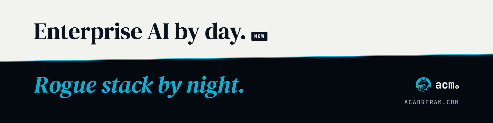

<picture>
  <source media="(prefers-color-scheme: dark)" srcset="assets/header-night.png">
  
</picture>

**Alex Cabrera**, Copilot Solution Engineer at Microsoft. By day I take Copilot and agents to production, with governance. By night, my agents and I build **Seiryū**, a personal platform of AI agents.

[acabreram.com](https://acabreram.com) · [Writing](https://acabreram.com/blog/) · [LinkedIn](https://www.linkedin.com/in/alexcabreram) · [RSS](https://acabreram.com/rss.xml)

---

### Seiryū — the dragon is its agents

Salem is the pearl the dragon holds: it remembers, understands intent and coordinates the rest. Two guardians are being built around it: Genbu, so that every real effect passes a permission boundary and a human gate on its way to signed policy, and Byakko, an independent review with a veto before risky operations. The South stays empty on purpose.

| | Agent | What it does |
|:-:|---|---|
| 🟡 | **Salem** | Core. Memory, intent and coordination |
| 🟢 | **Roar** | Turns ideas into blog and LinkedIn drafts. A human decides what ships |
| 🟢 | **Ideas** | Captures links and ideas on the fly and summarises them |
| 🟢 | **Lore** | Second brain: what I read and learn, organised and searchable |
| 🟢 | **Monitor** | Watches the system's health and only speaks up when it matters |
| 🟢 | **DevOps** | Containers, deployments and infrastructure, always with review |
| 🟠 | **Builder** | From a task to a reviewed PR, with traceability |

🟢 Running · 🟠 Building · 🟡 Core — the full map lives at <a href="https://acabreram.com/#mapa">acabreram.com</a>.

---

### Writing

- [How I built a self-hosted homelab with local AI agents](https://acabreram.com/blog/homelab-local-ai-agents/) · Mar 2026 · Seiryū

What works, what breaks and why → <a href="https://acabreram.com/blog/">all writing</a>

---

### Certifications

Microsoft MVP Alumni · Professor at The Valley Business & Tech School · Speaker and mentor in tech communities

---

Personal views; they don't represent Microsoft. Drafted with agents, shipped by a human.
